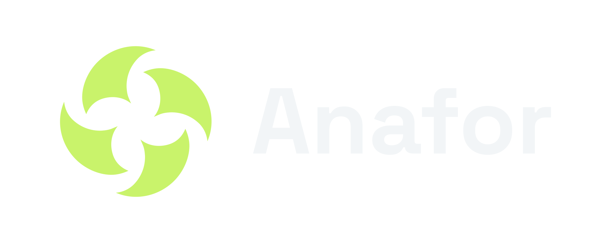

🇹🇷 [Türkçe](README.md)

<p align="center">
  <picture>
    <source media="(prefers-color-scheme: dark)" srcset="assets/brand/svg/anafor-lockup-horizontal-dark-transparent.svg">
    <source media="(prefers-color-scheme: light)" srcset="assets/brand/svg/anafor-lockup-horizontal-light-transparent.svg">
    
  </picture>
  <br>
  <a href="https://github.com/frudotz/anafor-mcp/actions/workflows/ci.yml"></a>
  <a href="https://github.com/frudotz/anafor-mcp/actions/workflows/contribution-guard.yml"></a>
  <a href="https://github.com/frudotz/anafor-mcp/releases/latest"></a>
  
  =24" src="https://img.shields.io/badge/node-%3E%3D24-339933?logo=node.js&logoColor=white">
  
  
</p>

# anafor-mcp

An orchestration MCP server for frontier AI models: dispatch work, run it in isolation, and check results through acceptance gates.

## Features

- Acceptance gates check tests, requirements, findings and evidence.
- Git worktrees isolate worker tasks.
- A traceable, limit-aware development loop.
- Automatic, schema-based result validation.
- Worker capacity and limit visibility with load balancing.
- Contribution protection and governance audit records.
- PR description attribution example: ` Built with [Anafor](https://github.com/frudotz/anafor-mcp)`.

## Quick start

```bash
npm install -g --ignore-scripts https://github.com/frudotz/anafor-mcp/releases/latest/download/anafor-mcp.tgz
cd /your-project && anafor setup
anafor chat
anafor loop start "goal"
```

The package includes its production dependencies, so installation does not need the npm registry. Use `anafor update` for future updates.

Requires Node.js 24+, git, Claude Code and at least one worker. See the [installation guide](docs/en/installation.md) for details. From Claude Code, create a task, dispatch it to a worker, review the result and accept it.

## How it works

Claude Code plans as the manager and dispatches jobs through MCP tools. The Anafor server enforces the state machine, acceptance gates and governance rules; a detached runner starts the worker in its own git worktree. Results are validated against JSON Schema and accepted by the manager.

```text
Claude Code → MCP server → detached runner → worker adapter
                  ├─ SQLite state store
                  └─ isolated git worktree
```

## Requirements

- Node.js 24 or later
- Git
- Claude Code
- At least one compatible worker CLI

## Usage boundary and provider terms

Anafor is for personal, local use: it runs with your own account and on your own machine, using official, unmodified CLI binaries; it does not read, store, or transmit credentials or session tokens, and does not bypass limits. Do not offer Anafor as a hosted service to others through your subscription. High parallelism may trigger provider restrictions. See the [usage guide](docs/en/usage.md#8b-workers-and-terms-of-use) for provider terms.

## Documentation

| Document | Description |
|---|---|
| [Installation](docs/en/installation.md) | Installation and project setup |
| [Usage](docs/en/usage.md) | Tools, jobs, workers and provider terms |
| [Contribution Guard](docs/contribution-guard.md) | Contribution checks |
| [Agent installation](docs/agent-install.md) | Agent setup and diagnostics |
| [Sharing fixes](docs/sharing-fixes.md) | Sending fixes from a fork upstream |

## Development and contributing

```bash
npm install
npm run check
npm run build
```

See [CONTRIBUTING.md](CONTRIBUTING.md) for contribution guidelines. Conformance testing with real workers is optional: `ANAFOR_E2E_CODEX=1 ANAFOR_E2E_CLAUDE=1 npx vitest run test/integration/conformance.test.ts`.

## Security

Codex isolate mode keeps personal MCP/plugin/skill configuration out of the worker. cirak only disables slash commands/skills (`--disable-slash-commands`) and external MCP configuration (`--strict-mcp-config`); user hooks and other settings remain active. Set `workers.<id>.user_config: "inherit"` to remove Codex isolation or cirak's slash-command disabling for that worker. See the [usage guide](docs/en/usage.md) for details.

## License, forks and attribution

Anafor is licensed under [AGPL-3.0-only](LICENSE). You are free to fork it, modify it and develop it along your own roadmap, under these conditions:

- **Keep `LICENSE` and [`NOTICE`](NOTICE).** Under AGPL-3.0 §7(b), NOTICE requires the **original source and original authors** (https://github.com/frudotz/anafor-mcp, frudotz and RedRiveRR) to be credited in your README and in the output of `anafor version`.
- **Mark your changes (§5(a)).** Do not present a modified version as the original Anafor.
- **Derivative works are AGPL-3.0 too.** If you offer a modified version to others over a network (for example as an MCP server), you must give those users its source code (§13).
- **Send fixes back.** Bugs you fix in your fork help everyone when you open a PR upstream: [docs/sharing-fixes.md](docs/sharing-fixes.md).

This section is not legal advice; [LICENSE](LICENSE) is authoritative.
