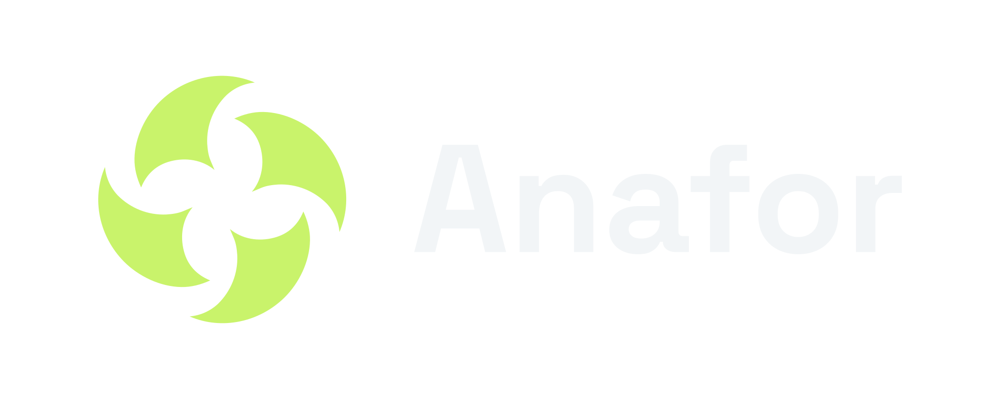

🇬🇧 [English](README.en.md)

<p align="center">
  <picture>
    <source media="(prefers-color-scheme: dark)" srcset="assets/brand/svg/anafor-lockup-horizontal-dark-transparent.svg">
    <source media="(prefers-color-scheme: light)" srcset="assets/brand/svg/anafor-lockup-horizontal-light-transparent.svg">
    
  </picture>
  <br>
  <a href="https://github.com/frudotz/anafor-mcp/actions/workflows/ci.yml"></a>
  <a href="https://github.com/frudotz/anafor-mcp/actions/workflows/contribution-guard.yml"></a>
  <a href="https://github.com/frudotz/anafor-mcp/releases/latest"></a>
  
  =24" src="https://img.shields.io/badge/node-%3E%3D24-339933?logo=node.js&logoColor=white">
  
  
</p>

# anafor-mcp

Frontier yapay zekâ modelleri için orkestrasyon MCP sunucusu: işleri dağıtır, yalıtılmış biçimde yürütür ve sonuçları kabul kapılarından geçirir.

## Özellikler

- Kabul kapıları; test, gereksinim, bulgu ve kanıt denetimi.
- Git worktree ile işçi görevleri için yalıtılmış çalışma alanları.
- Limit uyumlu, izlenebilir geliştirme döngüsü.
- Şema tabanlı otomatik sonuç doğrulama.
- İşçi kapasitesi ve limitlerinin görünürlüğü, yük dengeleme.
- Katkı koruması ve yönetişim denetim kayıtları.
- PR açıklaması atıf örneği: ` [Anafor](https://github.com/frudotz/anafor-mcp) ile geliştirildi`.

## Hızlı başlangıç

```bash
npm install -g https://github.com/frudotz/anafor-mcp/releases/latest/download/anafor-mcp.tgz
cd /projen && anafor setup
anafor chat
anafor loop start "hedef"
```

Node.js 24+, git, Claude Code ve en az bir işçi gerekir. Kurulum ayrıntıları: [Kurulum kılavuzu](docs/kurulum.md). Claude Code içinden görev oluşturup işçiye dağıtabilir, sonucu inceleyip kabul edebilirsiniz.

## Nasıl çalışır

Claude Code yönetici rolünde planlar ve MCP araçlarıyla işleri dağıtır. Anafor sunucusu durum makinesini, kabul kapılarını ve yönetişim kurallarını uygular; ayrık runner işçiyi kendi git worktree'sinde çalıştırır. Sonuçlar JSON Schema ile doğrulanır ve yönetici tarafından kabul edilir.

```text
Claude Code → MCP sunucusu → ayrık runner → işçi adaptörü
                    ├─ SQLite durum deposu
                    └─ yalıtılmış git worktree
```

## Gereksinimler

- Node.js 24 veya üzeri
- Git
- Claude Code
- En az bir uyumlu işçi CLI'sı

## Kullanım sınırı ve sağlayıcı koşulları

Anafor kişisel ve yerel kullanım içindir: kendi hesabınızda ve makinenizde, resmi ve değiştirilmemiş CLI'larla çalışır; kimlik bilgisi veya oturum token'ı okumaz, saklamaz ya da aktarmaz ve limit atlatmaz. Anafor'u aboneliğiniz üzerinden başkalarına barındırılmış hizmet olarak sunmayın. Yüksek paralellik sağlayıcı kısıtlamalarına yol açabilir. Sağlayıcı koşulları için [kullanım kılavuzuna](docs/kullanim.md#8b-işçiler-ve-kullanım-koşulları) bakın.

## Belgeler

| Belge | Açıklama |
|---|---|
| [Kurulum](docs/kurulum.md) | Kurulum ve proje yapılandırması |
| [Kullanım](docs/kullanim.md) | Araçlar, işler, işçiler ve sağlayıcı koşulları |
| [Katkı koruması](docs/contribution-guard.md) | Katkı denetim kapısı |
| [Ajan kurulumu](docs/agent-install.md) | Ajanlar için kurulum ve tanılama |
| [Düzeltmeleri paylaşma](docs/sharing-fixes.md) | Çataldan upstream'e düzeltme gönderme |

## Geliştirme ve katkı

```bash
npm install
npm run check
npm run build
```

Katkı kuralları: [CONTRIBUTING.md](CONTRIBUTING.md). Gerçek işçilerle uyum testi isteğe bağlıdır: `ANAFOR_E2E_CODEX=1 ANAFOR_E2E_CLAUDE=1 npx vitest run test/integration/conformance.test.ts`.

## Güvenlik

Codex isolate modunda kullanıcı MCP/plugin/skill yapılandırmalarından yalıtılır. cirak yalnızca slash komutlarını/skill'leri (`--disable-slash-commands`) ve dış MCP yapılandırmasını (`--strict-mcp-config`) kapatır; kullanıcının hook ve diğer ayarları etkin kalır. `workers.<id>.user_config: "inherit"`, ilgili işçi için Codex yalıtımını veya cirak slash komutu kapatmasını kaldırır. Ayrıntılar için [kullanım kılavuzuna](docs/kullanim.md) bakın.

## Lisans, çatallar ve atıf

Anafor [AGPL-3.0-only](LICENSE) lisanslıdır. Çatallamak (fork), değiştirmek ve kendi yol haritanızla geliştirmek serbesttir. Bunu yaparken uymanız gereken koşullar:

- **`LICENSE` ve [`NOTICE`](NOTICE) dosyalarını koruyun.** NOTICE, AGPL-3.0 §7(b) kapsamında **orijinal kaynağın ve asıl geliştiricilerin** (https://github.com/frudotz/anafor-mcp, frudotz ve RedRiveRR) README'nizde ve `anafor version` çıktısında belirtilmesini şart koşar.
- **Değişiklikleri işaretleyin (§5(a)).** Değiştirilmiş bir sürümü orijinal Anafor gibi sunmayın.
- **Türetilmiş çalışmalar da AGPL-3.0 ile lisanslanır.** Değiştirilmiş bir sürümü ağ üzerinden başkalarına sunuyorsanız (örneğin bir MCP sunucusu olarak), o kullanıcılara kaynak kodunu sağlamanız gerekir (§13).
- **Düzeltmeleri geri gönderin.** Çatalınızda düzelttiğiniz hataları ana repoya PR olarak gönderirseniz herkes yararlanır: [docs/sharing-fixes.md](docs/sharing-fixes.md).

Bu bölüm hukuki tavsiye değildir; bağlayıcı metin [LICENSE](LICENSE) dosyasıdır.
